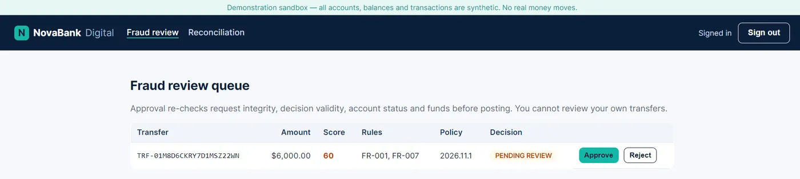
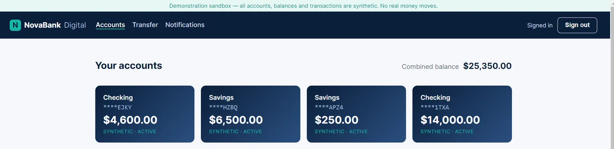
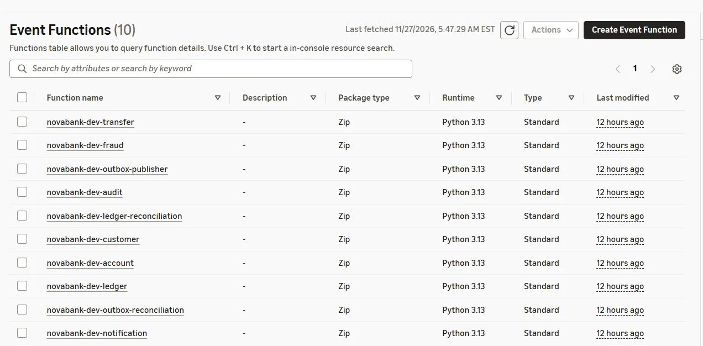
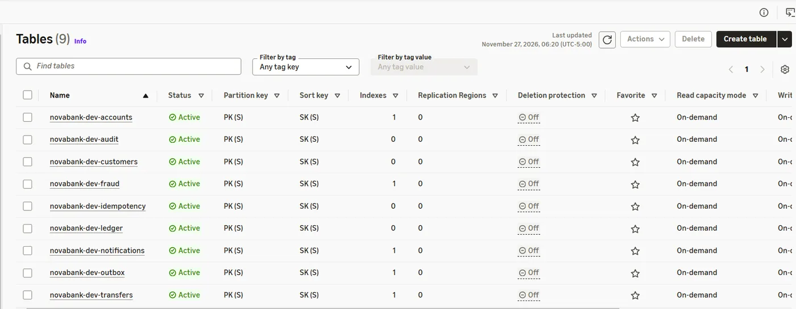
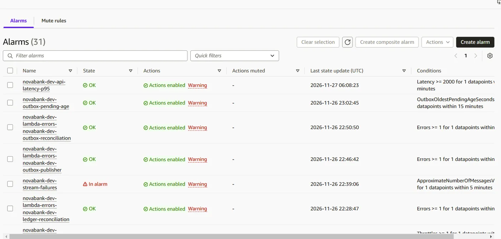
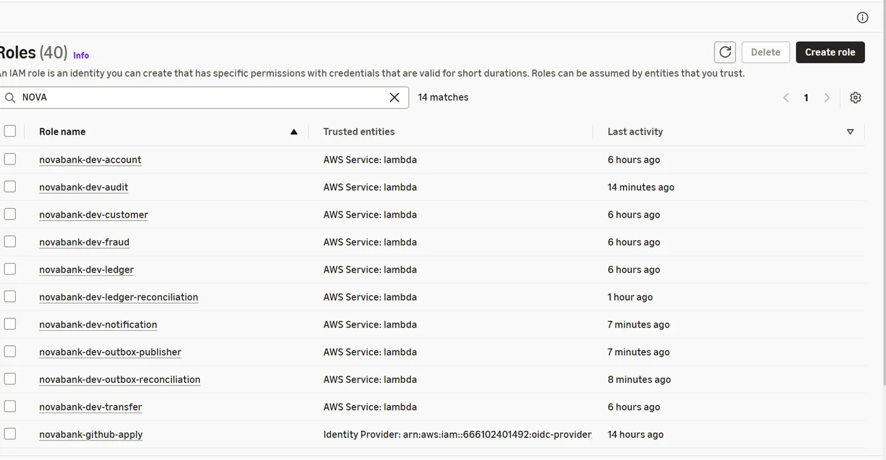
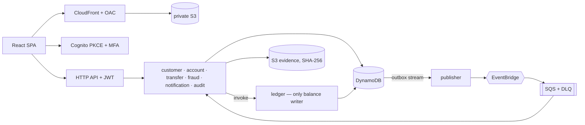

# NovaBank Digital — Cloud-Native Banking Microservices Platform

> **Synthetic demonstration sandbox.** No real money, no real customer or
> cardholder data, no payment-network connectivity. All balances are fictional.

A secure, event-driven digital-banking platform on AWS that focuses on
**distributed application architecture and financial transaction integrity**:
seven independently deployable Python 3.13 microservices on Lambda, a
double-entry ledger with atomic DynamoDB transactions, durable idempotency, a
transactional outbox, explainable fraud screening with reviewed holds, audit
evidence, and a DevSecOps pipeline with GitHub OIDC.

Project 4 of a cloud-engineering portfolio (after AIOps, Internal Developer
Platform, and Security & Compliance projects).

## Status
The AWS dev environment ran from 26 to 28 November 2026 and was then removed by the approved teardown (T30). There is no live site now; everything below can be rebuilt from code.

| Area | Status |
|---|---|
| Design, services, ledger, fraud, events, frontend | ✅ complete; 177 Python + 31 frontend tests pass in CI |
| Bootstrap (state, artifacts, GitHub OIDC roles) | ✅ applied 2026-11-26 |
| Dev environment (182 resources via Terraform + GitHub Actions) | ✅ deployed 2026-11-26, torn down 2026-11-28 (rebuild: [`scripts/rebuild_from_cloudshell.sh`](scripts/rebuild_from_cloudshell.sh)) |
| Live validation | ✅ 14 of 30 scenarios proven on the live system (T01–T03, T05–T08, T11, T15, T16, T18, T27, T29, T30); all 30 covered in CI or offline |
| Teardown (T30) | ✅ 2026-11-28: `cleanup` run [46098404662](https://github.com/oteyami2001/Cloud-Native-Banking-Microservices-Platform/actions/runs/46098404662) destroyed all 182 dev resources in 3 min 50 s; automated check and AWS console found none left ([after-teardown screenshots](docs/aws-console-evidence.md#after-teardown-t30-2026-11-28)). Only the bootstrap layer is kept |

**Case study:** [`docs/case-study.html`](docs/case-study.html) (architecture, live evidence, screenshots) · [final report](docs/phase-reports/final-report.md) · estimated cost ≈ $5.50–9.50/month while running, ≈ $0.25–0.50 for the whole demo, cents per month since teardown ([cost model](docs/cost-model.md)).
Evidence: [validation register](docs/validation-scenarios.md) · [portfolio evidence log](docs/portfolio-evidence.md).

| Fraud review queue | Balances after approval |
|---|---|
|  |  |

**AWS console:** [17 screenshots](docs/aws-console-evidence.md) of the dev environment while it was live (Lambda, API Gateway, Cognito, DynamoDB, EventBridge, SQS, S3, CloudWatch, IAM, Budgets), plus 3 after teardown.

| Lambda: 10 functions | DynamoDB: 9 tables |
|---|---|
|  |  |
| **CloudWatch: 31 alarms** | **IAM: one role per function** |
|  |  |

## Architecture

More: [architecture](docs/architecture.md) · [transfer sequence](diagrams/transfer-sequence.mmd) ·
[data model](docs/database-design.md) · [ADRs](docs/adr/README.md).

### A $250 transfer, atomically
One `TransactWriteItems`: debit checking (only if balance ≥ 25000, ACTIVE, USD,
owned by caller) · credit savings · two immutable entries · journal header
(posts once) · permanent posting record · transfer `APPROVED_FOR_POSTING → COMPLETED`
· `TransferCompleted` outbox event. All or nothing.

## Quick start (no AWS account needed)
```bash
make install          # venv + pinned dev dependencies
make test             # 177 tests: unit, contract, security, invariants, concurrency, terraform-static
make local-api        # offline API on http://127.0.0.1:8080 (moto-backed)
make demo             # in another shell: $250 transfer + fraud hold/approve/reject
cd frontend && npm ci && npm run dev   # UI on http://localhost:5173 (sandbox mode)
```
Terraform (offline): `make tf-validate tf-test`. Security scans: `make security`.

## Repository layout
| Path | Contents |
|---|---|
| `services/` | customer, account, ledger, transfer, fraud, notification, audit |
| `workers/` | outbox publisher, outbox reconciliation, ledger reconciliation |
| `shared/` | auth, money, idempotency, logging, errors, contracts, HTTP router, clients |
| `contracts/` | OpenAPI 3.1 and event JSON Schemas |
| `policies/` | fraud rules, security controls, compliance mapping, exceptions |
| `terraform/` | bootstrap, 14 modules, dev/staging/prod roots, reference designs (ECS, EKS, Aurora) |
| `.github/workflows/` | ci, security-scan, plan, apply, build, deploy, frontend, integration, reconciliation, drift, cleanup |
| `frontend/` | React + TypeScript + Vite banking UI |
| `tests/` | unit, integration, contracts, concurrency, financial invariants, security, terraform |
| `scripts/` | discovery, build, deploy/rollback, local API, simulations, reconciliation, cleanup checks |
| `runbooks/`, `docs/`, `diagrams/` | operations, design, Mermaid diagrams |

> Naming note: worker directories use underscores (`outbox_publisher`) instead
> of the proposal's hyphens so they are importable Python packages.

## Key documents
[Business & accounting model](docs/banking-business-model.md) ·
[Microservices](docs/microservices-design.md) · [API](docs/api-design.md) ·
[Security model](docs/security-model.md) · [Threat model](docs/threat-model.md) ·
[Compliance mapping](docs/compliance-mapping.md) · [Cost model](docs/cost-model.md) ·
[Bootstrap](docs/bootstrap-runbook.md) · [Deployment](docs/deployment-runbook.md) ·
[DR](docs/disaster-recovery.md) · [AWS console screenshots](docs/aws-console-evidence.md) · [Evidence log](docs/portfolio-evidence.md) · [Final report](docs/phase-reports/final-report.md)

## Guardrails
No AWS changes without approval · no force-push or unapproved merges · no real
financial data · integer minor units only · no partial or duplicate postings ·
no invented results · no compliance or certification claims.

## License
MIT — see [LICENSE](LICENSE).
