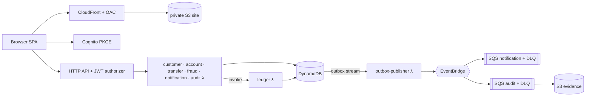

# Architecture

NovaBank Digital is a **synthetic** digital-banking platform: no real money,
no real customer data, no payment-network connectivity.

## Logical architecture
Diagram source: [`diagrams/architecture.mmd`](../diagrams/architecture.mmd).

## Components
| Layer | Service | Notes |
|---|---|---|
| Edge | CloudFront (OAC, security headers, HTTPS-only; TLS 1.2 minimum needs a custom domain + ACM, not in MVP) | Optional WAF (`web_acl_arn`); WAF cannot attach to an HTTP API directly, so API abuse controls are stage throttling + validation |
| Identity | Cognito | Code + PKCE, MFA, scopes, groups |
| API | API Gateway HTTP API | 16 routes, JWT on every route, throttling 25 rps / burst 50 (dev), access logs without headers |
| Compute | 10 Lambda functions (arm64, Python 3.13) | One role each, permissions boundary, X-Ray active, `live` alias |
| Data | 9 DynamoDB tables (on-demand) | PITR on system-of-record tables; outbox stream |
| Events | EventBridge custom bus + archive | Rules to SQS; delivery DLQ |
| Async | SQS (SSE) with DLQs | `ReportBatchItemFailures` |
| Evidence | S3 versioned, SSE-KMS, TLS-only | Writers restricted by bucket policy |
| Ops | CloudWatch EMF metrics, 31 alarms, dashboard, SNS | Low-cardinality dimensions |
| Cost | AWS Budgets ($25 monthly) | Project tag filter; e-mail alerts only when `alert_email` is set (it was not in dev) |

## Integration constraints identified (Phase 1 review)
| Topic | Finding | Design response |
|---|---|---|
| WAF + HTTP API | AWS WAF associates with REST API stages, CloudFront, ALB, AppSync, Cognito — **not** HTTP APIs | WAF optional on CloudFront only; API protected by JWT, throttling, validation |
| `TransactWriteItems` | ≤100 items, ≤4 MB, one operation per item, 2× capacity cost | Transfers use 8 items; self-transfers rejected (same item twice is invalid anyway) |
| Transaction idempotency token | `ClientRequestToken` only lasts 10 minutes | Durable records (ADR-0006) |
| GSIs | Eventually consistent | Never used for balances/eligibility; listing only |
| Streams + Lambda | At-least-once; retries block the shard | Bounded retries, bisect, on-failure destination, outbox reconciliation |
| EventBridge `PutEvents` | ≤10 entries; partial failure returns per-entry errors | Chunking and per-entry checks |
| HTTP API JWT authorizer + Cognito access tokens | Access tokens carry `client_id` not `aud`; authorizer accepts either | Audience configured as the SPA client id; services re-check `client_id` |
| Cognito groups in HTTP API claims | Arrays arrive as strings (`"[a b]"`) | Parser handles both forms |
| Lambda alias + API integration | Permission must target the qualified alias | `aws_lambda_permission.qualifier = "live"` |
| DynamoDB restore | Creates a new table without streams/PITR | Runbook includes re-enabling and reconciliation |
| Lambda in VPC | Would require NAT/endpoints | Not used (ADR-0001) |
| Teardown of the evidence bucket | A versioned bucket with objects cannot be deleted | `evidence_force_destroy=true` only in the cleanup workflow; the cleanup role is an allowed writer so it can empty the bucket |
| Teardown of CloudFront | A distribution must be disabled before deletion | Accounts for most of the destroy time (3 min 12 s of 3 min 50 s in T30) |
| Teardown verification | The cleanup role cannot call `iam:ListRoles` or `tag:GetResources` | `verify_cleanup.sh` reports such checks as NOT CHECKED instead of "none" |

## Lifecycle: two layers
| Layer | Terraform root | Contents | State |
|---|---|---|---|
| Bootstrap | `terraform/bootstrap` (25 resources) | State bucket, artifact bucket, GitHub OIDC roles (plan, apply, deploy, cleanup) | Applied 2026-11-26; **kept** |
| Dev environment | `terraform/envs/dev` (182 resources) | Everything in the diagram and table above | Applied 2026-11-26; **destroyed 2026-11-28 (T30)** |

The dev layer is disposable by design: the `cleanup` workflow destroys it only after a typed
confirmation and approval on a protected GitHub environment, and never touches the bootstrap
layer. T30 ([run 46098404662](https://github.com/oteyami2001/Cloud-Native-Banking-Microservices-Platform/actions/runs/46098404662))
removed all 182 resources in 3 min 50 s; nothing project-owned is left in the dev layer
([evidence](aws-console-evidence.md#after-teardown-t30-2026-11-28)). Because the bootstrap
layer survives, the whole environment can be rebuilt from code with the pipelines or
`scripts/rebuild_from_cloudshell.sh` ([deployment runbook](deployment-runbook.md)); a rebuild
gets new API, site and Cognito addresses.

## Production reference (not deployed)
Multi-AZ VPC with private subnets, interface endpoints, internal ALB via VPC
Link for containerised services, Aurora PostgreSQL ledger option, customer
managed KMS keys, WAF, custom domain with ACM, separate accounts per
environment (Landing Zone project). See `terraform/reference/`.
