# AWS console evidence (dev, us-east-2)

Screenshots of the deployed `novabank-dev` environment, taken in the AWS console on
2026-11-27, the day after the Terraform apply. The environment was torn down on
2026-11-28 (T30), so these resources no longer exist. They show the resources described in the
[AWS resource inventory](aws-resource-inventory.md). All data shown is synthetic.

## Compute: AWS Lambda
All 10 functions (7 services, 3 workers), Python 3.13, zip packages deployed by the pipeline.

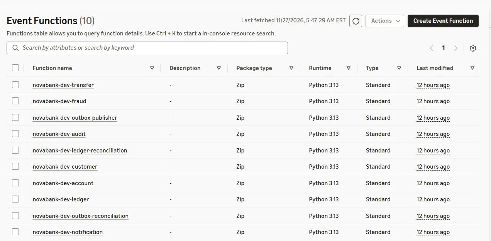

The ledger function has no trigger and no public route. Only the account and transfer
services may invoke it.

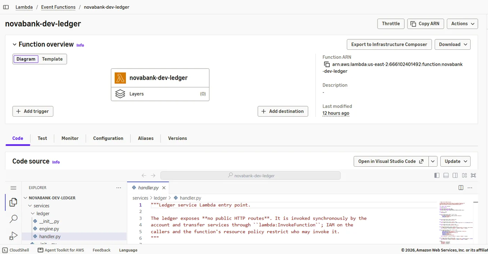

## API: Amazon API Gateway
One regional HTTP API, `novabank-dev-api`.

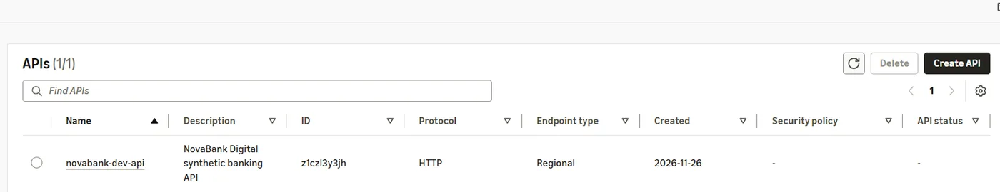

Every route has the Cognito JWT authorizer attached.

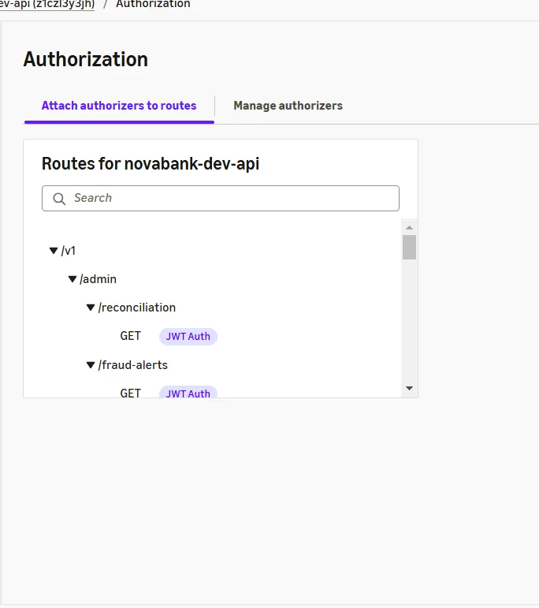

## Identity: Amazon Cognito
User pool `novabank-dev-users`, with the three role groups the API checks.

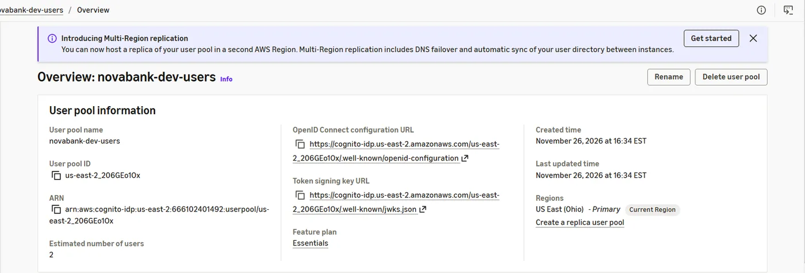

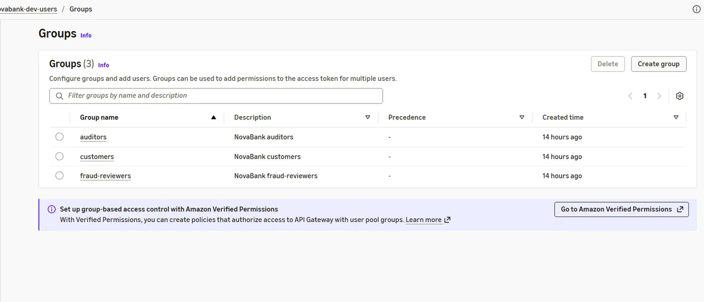

## Data: Amazon DynamoDB
Nine on-demand tables.

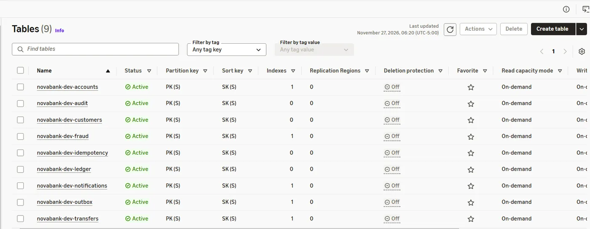

The ledger table, the financial system of record, with point-in-time recovery on.
PITR is enabled on the financial tables only. `novabank-dev-notifications` holds derived
data and has it off by design (`terraform/modules/dynamodb`).

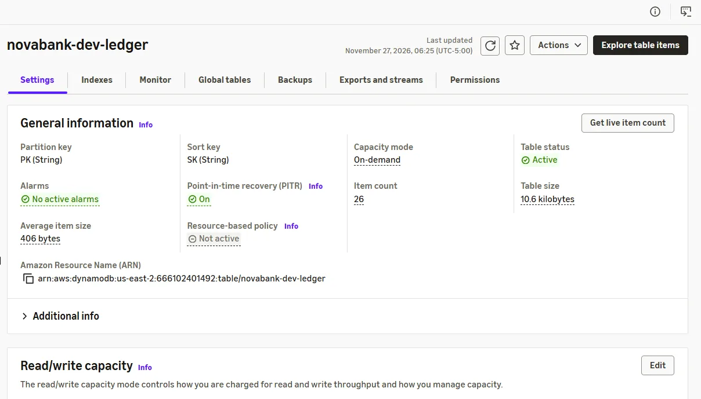

## Events: Amazon EventBridge
The custom bus `novabank-dev-events` with its archive rule and the two rules that route
events to the audit and notification queues.

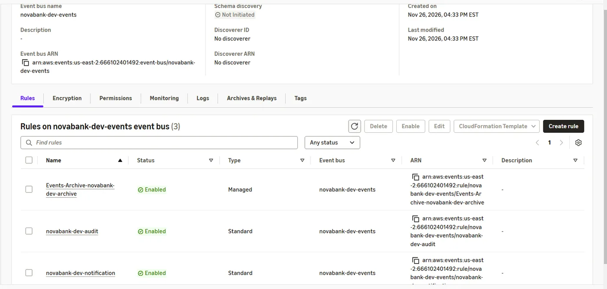

The two scheduled jobs: outbox reconciliation (every 5 minutes) and ledger
reconciliation (every hour).

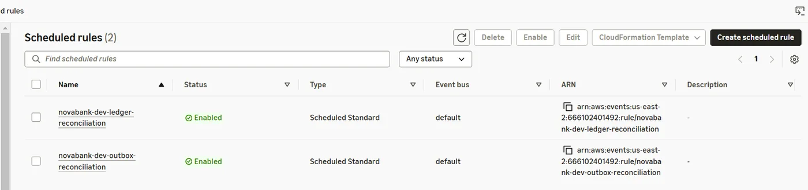

## Messaging: Amazon SQS
Seven queues, all encrypted (SSE-SQS). Every dead-letter queue is at 0 messages.

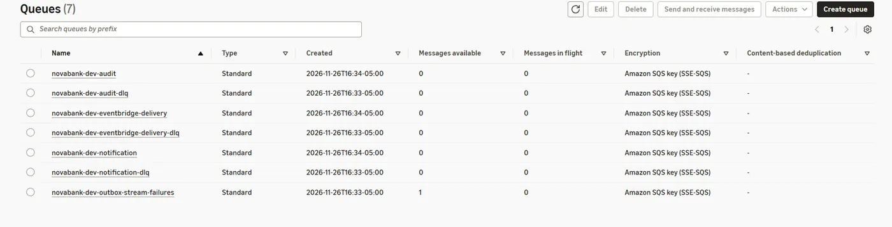

`novabank-dev-outbox-stream-failures` holds 1 message. It captures DynamoDB Stream
batches the outbox publisher could not process. Its alarm (below) fired for this message.
The outbox reconciliation job republishes pending events, so the event itself is not
lost, but the message should be inspected and the queue cleared.

## Storage: Amazon S3
The four project buckets: Terraform state and Lambda artifacts (bootstrap), plus the
private website bucket and the versioned, KMS-encrypted evidence bucket.

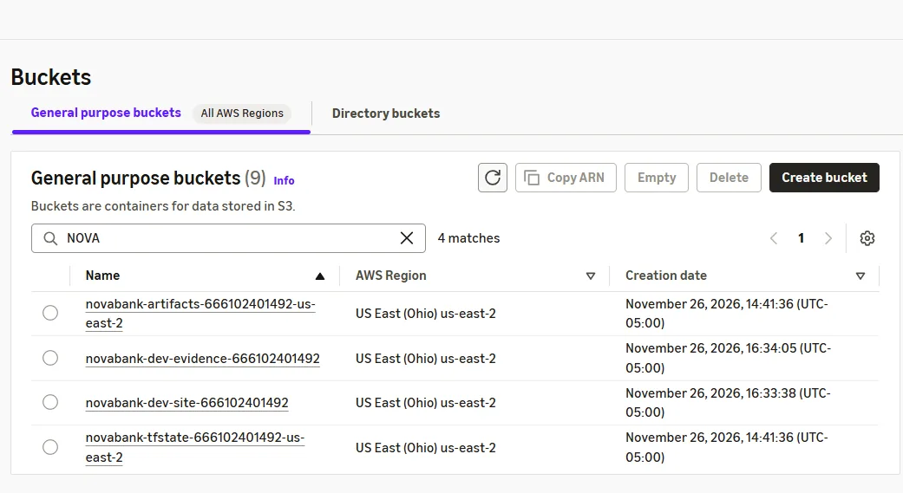

## Monitoring: Amazon CloudWatch
Alarms by service: 30 OK, 1 in alarm (the stream-failures queue above).

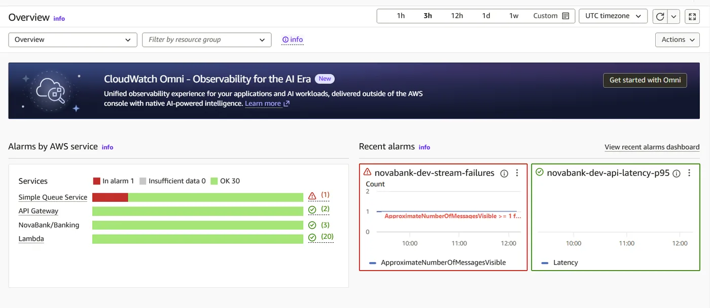

The 31 `novabank-dev-*` alarms.

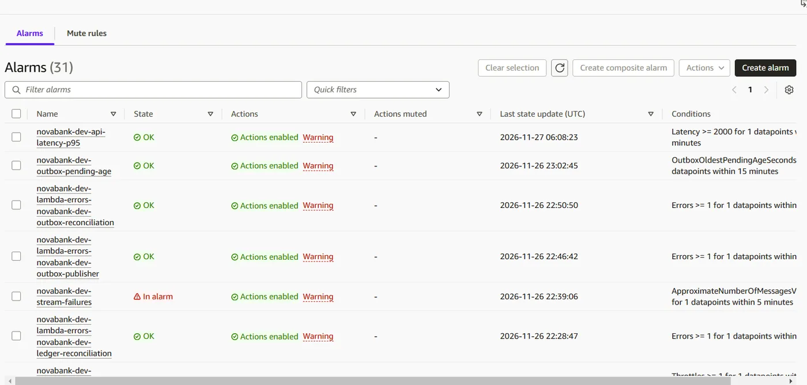

One log group per function plus the API access log, each with 2-week retention.

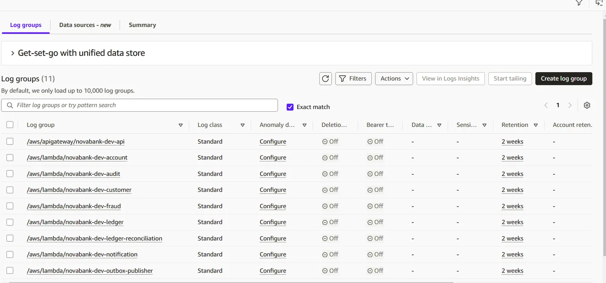

## Security: AWS IAM
One role per function (least privilege, shared permissions boundary), plus the GitHub
roles that trust only the GitHub OIDC provider.

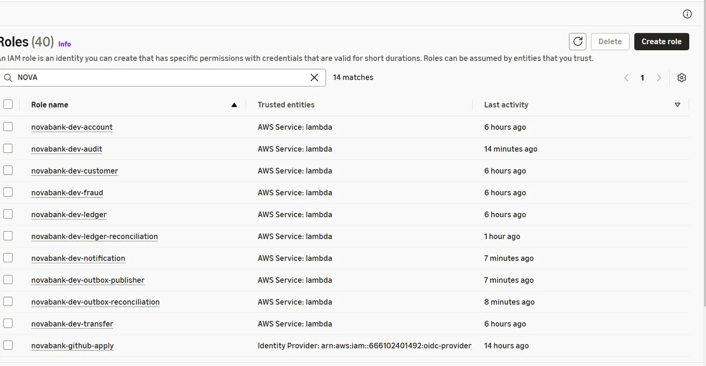

## Cost: AWS Budgets
The `novabank-dev-monthly` cost budget ($25, filtered on the Project tag). It shows
$0.00 spent so far. No alert thresholds are set because no notification e-mail was
configured. Setting `alert_email` in `terraform/envs/dev` adds alerts at 50%, 80% and
100% of actual spend and 100% of forecast spend.

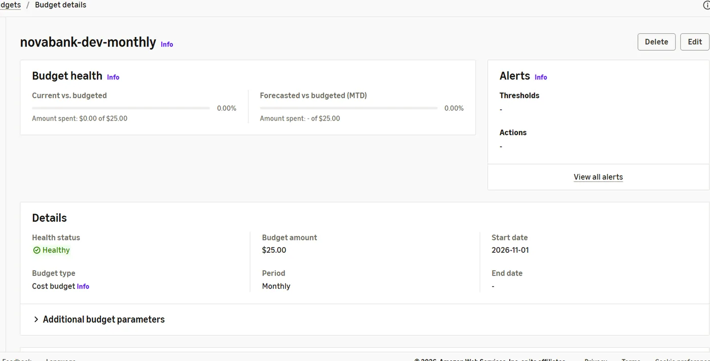

## After teardown (T30, 2026-11-28)
The same console pages after the `cleanup` workflow: no Lambda functions, no DynamoDB
tables and no CloudWatch alarms or dashboards left in us-east-2.

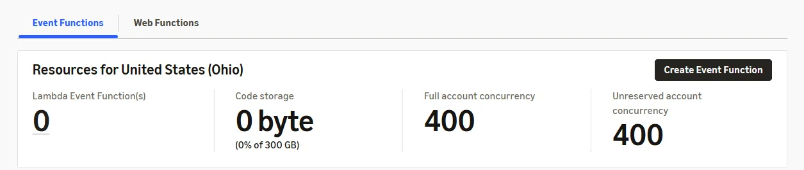

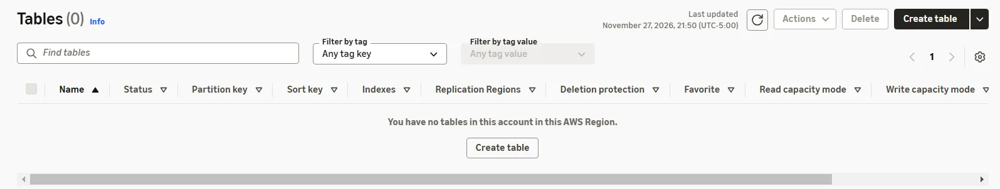

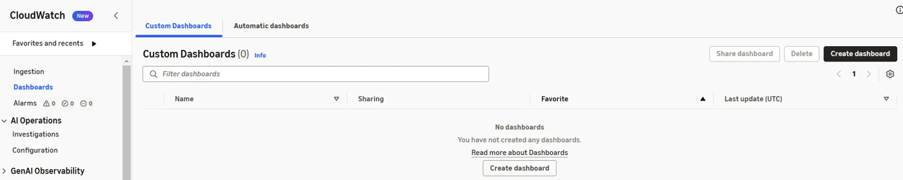
