# Microservices design

## Responsibility matrix
| Service | Owns (data) | Public routes | Internal actions | Calls | Events produced |
|---|---|---|---|---|---|
| customer | profiles, identity pointers | `POST /v1/customers`, `GET/PATCH /v1/customers/me` | – | – | CustomerCreated |
| account | account metadata | `POST/GET /v1/accounts`, `GET /v1/accounts/{id}`, `/balance`, `/transactions` | `get_for_transfer` | ledger | AccountCreated |
| ledger | balances, entries, journals, posting records | none | `open_account`, `get_balance`, `list_entries`, `set_status`, `post_opening_balance`, `post_transfer`, `reverse_transfer` | – | OpeningBalancePosted, TransferCompleted, TransferReversed |
| transfer | transfer lifecycle, request idempotency | `POST /v1/transfers`, `GET /v1/transfers/{id}`, admin approve/reject | `resume_posting` | account, fraud, ledger | TransferRequested, TransferPendingReview, TransferRejected |
| fraud | rules, decisions, recipients, alerts | `GET /v1/admin/fraud-alerts` | `screen`, `get_decision`, `record_review`, `set_flag` | – | FraudScreeningCompleted, FraudAlertRaised |
| notification | delivery records | `GET /v1/notifications` | SQS consumer | – | (metrics NotificationDelivered) |
| audit | evidence index, reports | `GET /v1/admin/reconciliation`, `GET /v1/admin/audit/transfers/{id}` | SQS consumer | – | – |
| outbox-publisher | – | – | stream consumer | EventBridge | – |
| outbox-reconciliation | – | – | scheduled | EventBridge | – |
| ledger-reconciliation | reconciliation reports | – | scheduled | S3 | ReconciliationCompleted |

Each service has its own IAM role (see `terraform/modules/platform/main.tf`,
`local.services`), log group, artifact, tests and contract.

## Transfer state machine

```mermaid
stateDiagram-v2
  [*] --> SCREENING: request accepted (idempotent)
  SCREENING --> APPROVED_FOR_POSTING: fraud APPROVED
  SCREENING --> PENDING_REVIEW: fraud score ≥ 40
  SCREENING --> REJECTED: fraud score ≥ 90
  SCREENING --> FAILED: fraud unavailable (fail closed)
  PENDING_REVIEW --> APPROVED_FOR_POSTING: reviewer approves (revalidated)
  PENDING_REVIEW --> REJECTED: reviewer rejects
  APPROVED_FOR_POSTING --> COMPLETED: ledger posting (atomic)
  APPROVED_FOR_POSTING --> REJECTED: insufficient funds / inactive / currency
  COMPLETED --> [*]
```

All transitions are conditional updates on the expected prior state.

## Communication
* **Synchronous** (Lambda invoke, ADR-0013): account→ledger; transfer→account, fraud, ledger.
* **Asynchronous** (outbox → EventBridge → SQS): notifications, audit evidence.
* Correlation id: `X-Correlation-Id` header (validated) or API Gateway request id;
  propagated in internal calls and every event envelope.

## Event contracts
Envelope: `event_id, event_type, schema_version, envelope_version, source,
producer, entity_id, occurred_at, correlation_id, deployment_version, data`.
JSON Schemas in `contracts/events/` (validated against emitted events in
`tests/contracts`). Additive changes keep `schema_version`; breaking changes
increment it and run both versions in parallel during migration.

## Error model
`{"error": {"code", "message", "correlation_id", "details?"}}` with stable
codes (`VALIDATION_ERROR`, `UNAUTHENTICATED`, `FORBIDDEN`, `NOT_FOUND`,
`INSUFFICIENT_FUNDS`, `ACCOUNT_NOT_ACTIVE`, `CURRENCY_MISMATCH`,
`IDEMPOTENCY_KEY_REUSED`, `REQUEST_IN_PROGRESS`, `TRANSFER_REJECTED`,
`SEPARATION_OF_DUTIES`, `DEPENDENCY_UNAVAILABLE`, `CONCURRENCY_CONFLICT`,
`INVALID_STATE`, `INTERNAL_ERROR`). Unexpected errors never leak internals.
